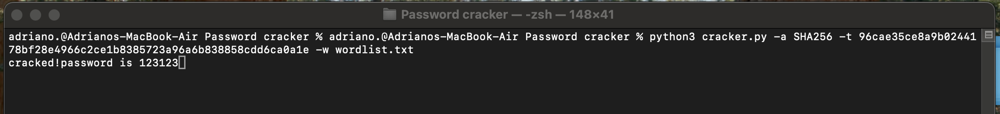

# Title 
A multi-Threaded password hash cracker written in python. Takes a hash and a wordlist and finds the matching password

## Why i built it
I created this project over my python class to further understand how to code and also build a tool to showcase my understanding of dictionary attacks and why weak passwords fail. 

## What it does 
- takes a target hash, a wordlist, and a hash algorithm as a command-line argument.
- hashes each word in the wordlist and compares it to the target.
- Uses threading so multiple words are checked at once.
- Stops as soon as it finds a match.
- supports different algorithms via `hashlib` (md5,sha1.sha256).

## How to run it 
```bash
python3 Password_Cracker.py -a sha256 -t [target_hash] -w wordlist.txt
```
Arguments:

- `-a` / `--algorithm` — the hash type (md5, sha1, sha256…)
- `-t` / `--target` — the hash you’re trying to crack
- `-w` / `--wordlist` — the path to your wordlist file

## what i learned/ Limitation
- it only cracks passwords found the wordlist.]
- No salt, real systems utilize salt for further complexity.
- learned how threading works and how it saves time, by checking every word at the same time.

-Disclaimer:
this tool was created for educational purposes only.